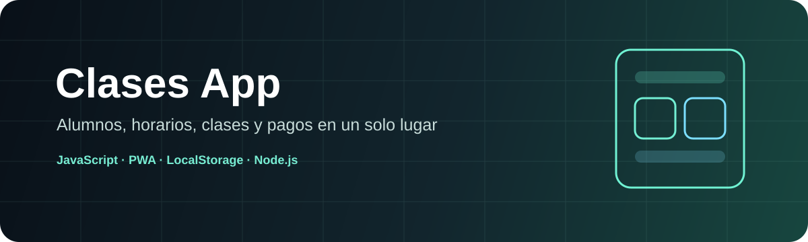
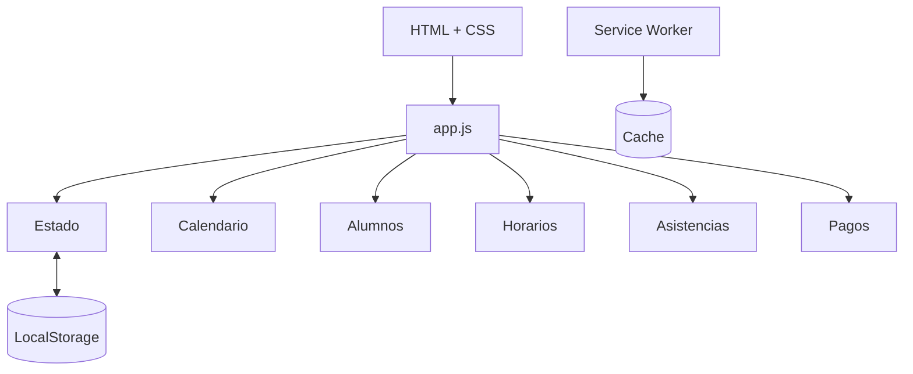

<p align="center">
  
</p>

<p align="center">
  
  
  
  
</p>

<p align="center">
  <a href="#clases-app">Resumen</a> ·
  <a href="#funciones">Funciones</a> ·
  <a href="#cómo-está-organizada">Organización</a> ·
  <a href="#tecnologías">Tecnologías</a> ·
  <a href="#ejecutarla">Ejecutarla</a> ·
  <a href="docs/ARCHITECTURE.md">Arquitectura</a>
</p>

## Clases App

Clases App es una aplicación que hice para llevar en un mismo lugar el seguimiento de **alumnos, horarios, clases y pagos**.

La aplicación funciona sin backend: guarda la información en el navegador mediante LocalStorage. También puede instalarse como PWA y utiliza un Service Worker para mantener en caché los archivos principales.

## Funciones

- alta y edición de alumnos;
- valor por hora y notas individuales;
- organización de horarios semanales;
- registro de clases dadas, no dadas o reprogramadas;
- cambio de fecha y hora de una clase;
- registro de pagos;
- paquetes o combos de horas;
- control de horas disponibles por alumno;
- avisos cuando quedan pocas horas;
- agenda y calendario;
- historial de movimientos;
- exportación de datos.

## Cómo está organizada



La lógica principal está concentrada en `app.js`. Desde ahí se manejan formularios, cálculos, cambios de estado y actualización de las distintas vistas.

Los datos se organizan alrededor de este estado:

```text
state
├── students
├── schedules
├── classes
├── payments
└── combos
```

Cada cambio se vuelve a guardar en LocalStorage, por lo que la aplicación conserva la información en ese navegador sin depender de una base de datos externa.

## Tecnologías

| Parte | Herramientas |
| --- | --- |
| Interfaz | HTML, CSS |
| Lógica | JavaScript |
| Persistencia | LocalStorage |
| Instalación | Web App Manifest |
| Offline | Service Worker + Cache |
| Servidor local | Node.js |

No usa frameworks ni dependencias externas para la lógica principal.

<details>
<summary><strong>Ver estructura del proyecto</strong></summary>

```text
clases-app/
├── assets/
├── index.html
├── app.js
├── styles.css
├── sw.js
├── manifest.webmanifest
├── icon.svg
├── server.mjs
├── package.json
└── docs/
    └── ARCHITECTURE.md
```

</details>

## Ejecutarla

Con Node.js 18 o superior:

```bash
git clone https://github.com/alejoesp/clases-app.git
cd clases-app
npm start
```

Después se puede abrir en:

```text
http://127.0.0.1:4173
```

No hace falta instalar paquetes porque `server.mjs` utiliza módulos nativos de Node.js.

<details>
<summary><strong>Datos y funcionamiento offline</strong></summary>

Los datos quedan guardados en el navegador. Eso simplifica mucho la aplicación, aunque también significa que no hay sincronización automática entre distintos dispositivos.

El Service Worker mantiene en caché los archivos principales para que la interfaz pueda seguir cargando cuando no haya conexión.

</details>

## Documentación

En [docs/ARCHITECTURE.md](docs/ARCHITECTURE.md) está explicada con más detalle la estructura interna y la forma en que se relacionan las distintas partes de la aplicación.
